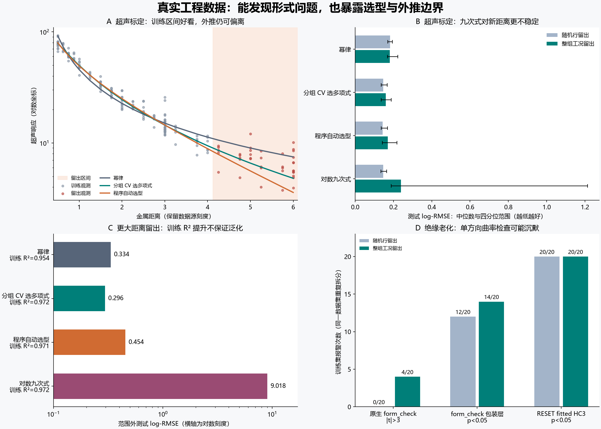

# form_check：真实工程数据的优势、过拟合风险与边界

日期：2026-09-05。使用两组官方实测数据，84 个训练／测试拆分、546 次模型拟合。
这是按任务目的选择的探索性案例验证，不是随机抽样的大规模优越性评测。
产品 `dimreflex/` 和 `common.py` 未修改，代码哈希核验通过。

## 主要判断

**它有价值，但价值目前主要是提示幂律可能失配，不能把自动选出的公式视为外推可靠。**
超声数据提供正面案例；老化数据提供单方向检查的边界；同一组超声数据又直接暴露了自动选型和复杂模型的泛化风险。
本次没有证明它优于 RESET：超声案例中各检验都报警，老化案例中 RESET 更稳定地报警。



## 数据与独立验证方式

- **Chwirut1：214 条超声标定实测数据**，输入为金属距离、输出为超声响应。
  来源：[NIST 数据说明](https://www.itl.nist.gov/div898/strd/nls/data/LINKS/i-chwirut1.shtml)、
  [原始数据](https://www.itl.nist.gov/div898/strd/nls/data/LINKS/DATA/Chwirut1.dat)。
- **Nelson：128 条绝缘性能退化实测数据**，输入为老化时间、温度，输出为击穿强度。
  来源：[NIST 数据说明](https://www.itl.nist.gov/div898/strd/nls/data/LINKS/i-nelson.shtml)、
  [原始数据](https://www.itl.nist.gov/div898/strd/nls/data/LINKS/DATA/Nelson.dat)。
  温度从摄氏度转换为开尔文后才进入幂律／对数模型。

两类随机拆分各重复 20 个固定种子：随机留出 25% 的行；按相同输入组合整组留出 25% 工况。
相同距离／相同时间温度组合的重复观测在分组拆分中不会跨训练和测试集。
这些重复拆分来自同一数据集，不是 20 份独立数据，频率不应当解释成检验功效或误报率。

范围外验证预先固定为：超声距离 **0.5–4.0 训练、4.25–6.0 测试**；另做中间范围 1.25–4.25 训练、两端测试。
老化时间 **1–32 周训练、48–64 周测试**；另做 **180–250°C 训练、275°C 测试**。
拆分仅依赖输入，报警、拟合、预处理、内层选型均只使用训练集。

主指标为 **log-RMSE，越低越好**。它是自然对数尺度上的均方根误差，不是百分比。
同时保存 log-R²、相对误差中位数与逐条预测。所有模型都拟合 log 响应，保持损失口径一致。
NIST 给出的函数形式只作参照，其参数全部在训练集重拟合；官方认证参数仅在计算完成后的解析审计中使用。
NIST 形式不是已知真值，本次拟合的目标也不是复现 Chwirut 的原尺度最小二乘认证解。

## 1. 能体现优势的地方：高拟合度没有挡住报警

超声数据中，随机行拆分的幂律训练 log-R² 中位数为 **0.9530**；整组留出时为 **0.9510**。
两种拆分中原生 `form_check` 均 **20/20 报警**。在更大距离留出中，训练 log-R² 仍为 **0.9537**，
原生 t=-8.129，包装层 p=0.001。
这说明它能在看似不错的拟合后继续提示形式问题。

下表均为测试 log-RMSE；随机拆分取 20 次中位数，范围外案例只做一个固定拆分。

| 超声验证方式 | 幂律 | 分组 CV 选多项式 | 原程序 discover_auto |
| --- | --- | --- | --- |
| 随机行留出 | 0.1828 | 0.1461 | 0.1437 |
| 整组工况留出 | 0.1808 | 0.1598 | 0.1696 |
| 更大距离 | 0.3341 | 0.2958 | 0.4543 |

随机行测试中，自动选型的误差中位数比幂律低约 **21%**；整组工况测试中仅低约 **6%**。
这是“报警后尝试其他形式可能有帮助”的证据，但并不意味着每个拆分都改善，也不是检验本身自动提高预测精度。
分组 CV 多项式是本次新增实验对照，不能记成产品现有能力。

## 2. 最值得注意的产品风险：自动选型的内部 CV 不能代表范围外误差

更大距离案例中，原程序选中了 `rational_log`，训练 log-R² 提高到 **0.9709**，
但测试 log-RMSE 从幂律的 **0.3341** 增到 **0.4543**，约恶化 **36%**。
它的内部 CV 误差只有 **0.1158**。这次升级在训练范围内看起来合理，在范围外却失败。

| 数据 | 留出方式 | 原程序所选族 | 内部 CV log-RMSE | 实际留出 log-RMSE | 比值 |
| --- | --- | --- | --- | --- | --- |
| Chwirut1 | 更大距离 | rational_log | 0.1158 | 0.4543 | 3.92× |
| Chwirut1 | 中间范围→两端 | rational_log | 0.1355 | 0.3325 | 2.45× |
| Nelson | 更长老化时间 | piecewise_power_law | 0.2729 | 0.6546 | 2.40× |
| Nelson | 更高温度 | piecewise_power_law | 0.1147 | 0.9988 | 8.71× |

这些比值比较的是不同预测任务的误差，说明适用范围差异，不是严格的无偏过拟合估计。
随机行交叉验证能评估相近输入范围内的预测，却不能验证没有见过的距离或温度。
分组 CV 也不能自动保证外推：例如其更高温度测试仍很差。

## 3. 明确的复杂度压力案例：训练更好，新工况更差

预先加入九次对数多项式作为刻意灵活的压力对照。它不是产品内置模型，也不用于宣传产品成绩。
在超声整组留出中，它的训练 log-R² 中位数达到 **0.9695**，优于幂律的 **0.9510**；
但测试 log-RMSE 中位数为 **0.2394**，差于幂律的 **0.1808**，且四分位范围扩大到 **[0.1886, 1.2139]**。
在更大距离测试中误差达到 **9.0178**。中间范围训练、两端测试时更出现原尺度溢出，已保留并标记。
它说明小幅训练拟合改善可以伴随非常不稳定的泛化；不能据此声称 form_check 会检查任意复杂模型的过拟合。
当前 form_check 检查的是幂律形式，复杂模型的风险仍需独立验证。

## 4. 不利结果：绝缘老化数据暴露检查盲区

Nelson 随机行拆分中，原生 3σ 报警为 **0/20**，包装成 p<0.05 后为 **12/20**；
整组拆分中分别为 **4/20** 和 **14/20**。RESET fitted F 与 fitted HC3 在两种拆分中均为 **20/20**。
两种 form_check 阈值不同，必须分列，不能把包装层成绩说成原生报警能力。

尤其是 **1–32 周训练、48–64 周测试**：原生不报警，包装层 p=**0.085**，
但幂律测试 log-RMSE 达到 **0.8212**，三次对数模型为 **0.3028**。
这是一例“没有报警也可能存在很大预测风险”。
当前实现只检查多特征平方项平均后的一个方向；对方向、交互和输入覆盖的敏感性是可能解释，
本次没有单独隔离其因果贡献。幂律本身在此例的训练拟合也不高，因此它主要检验边界，不是高 R² 漏检案例。

| 数据 | 方式 | 原生 3σ | 包装层 .05 | RESET F .05 | RESET fitted HC3 .05 | RESET exog HC3 .05 |
| --- | --- | --- | --- | --- | --- | --- |
| Chwirut1 | 随机行留出 | 20/20 | 20/20 | 20/20 | 20/20 | 20/20 |
| Chwirut1 | 整组工况留出 | 20/20 | 20/20 | 20/20 | 20/20 | 20/20 |
| Chwirut1 | 更大距离 | 1/1 | 1/1 | 1/1 | 1/1 | 1/1 |
| Chwirut1 | 中间范围→两端 | 1/1 | 1/1 | 1/1 | 1/1 | 1/1 |
| Nelson | 随机行留出 | 0/20 | 12/20 | 20/20 | 20/20 | 20/20 |
| Nelson | 整组工况留出 | 4/20 | 14/20 | 20/20 | 20/20 | 20/20 |
| Nelson | 更长老化时间 | 0/1 | 0/1 | 1/1 | 1/1 | 1/1 |
| Nelson | 更高温度 | 0/1 | 1/1 | 1/1 | 1/1 | 0/0（1 失败） |

“次数/可运行次数”是稳定性描述。高温留出的 exog HC3 发生秩亏，表中按失败报告，不能算成未报警。
真实数据没有已知条件均值，不能由这些频次计算真实功效或误报率。

## 5. 残差零分布敏感性

新增的实验性 HC3 残差 wild bootstrap 只对同一个曲率方向做敏感性检查，结果不属于产品功能。
它保留了超声范围外案例的报警，也没有改变老化长时间案例的沉默。
这能检查结论对一种替代重采样方案是否敏感，不能证明噪声独立或全面稳健。

| 数据 | 方式 | 原生 t | 包装层 p | 实验 wild p | RESET fitted HC3 p |
| --- | --- | --- | --- | --- | --- |
| Chwirut1 | 更大距离 | -8.129 | 0.001 | 0.001 | 8.25e-23 |
| Chwirut1 | 中间范围→两端 | -3.182 | 0.002 | 0.001 | 0.00359 |
| Nelson | 更长老化时间 | -1.596 | 0.085 | 0.164 | 7.93e-22 |
| Nelson | 更高温度 | -2.620 | 0.008 | 0.013 | 1.43e-08 |

## 6. 当前证据支持的改进方向

1. 在自动选型接口中增加用户可指定的工况分组和范围留出验证；分别报告区间内与范围外成绩。
2. 将“未发现幂律失配”与“模型可用于外推”明确分开，不把低内部 CV 误差当作范围外通行证。
3. 多变量检查应增加独立方向、交互方向或与 RESET 组合；后续必须在新数据上验证，避免围绕本次结果调参。
4. 超出训练包络时使用已有监视能力提示，但需要另行验证监视输出与预测入口是否形成完整流程。

本次只验证形式检查和模型选型，未验证完整量纲推导、生产监视或真实工程控制。
两套数据经过目的性选择且已知有非线性结构，不能据此给出整体准确率、误报率或普遍优越性结论。
重复观测的实验批次／试件标识不足，分组只能按已提供的输入组合进行，不能保证独立实验室泛化。
随机行和整组拆分的测试难度及部分训练样本数不同，二者差距不能单独归因于数据泄漏。

## 7. 全部模型成绩与配对稳定性

表内为 log-RMSE 中位数 [Q25,Q75]；单次范围留出的三个数相同，不是置信区间。

| 数据 | 方式 | 模型 | 成功/尝试 | 测试 log-RMSE |
| --- | --- | --- | --- | --- |
| Chwirut1 | 随机行留出 | 幂律 | 20/20 | 0.1828 [0.1710, 0.1948] |
| Chwirut1 | 随机行留出 | 对数二次式 | 20/20 | 0.1466 [0.1385, 0.1688] |
| Chwirut1 | 随机行留出 | 对数三次式 | 20/20 | 0.1455 [0.1364, 0.1669] |
| Chwirut1 | 随机行留出 | 对数九次式（压力对照） | 20/20 | 0.1459 [0.1338, 0.1640] |
| Chwirut1 | 随机行留出 | 分组 CV 选多项式 | 20/20 | 0.1461 [0.1364, 0.1669] |
| Chwirut1 | 随机行留出 | 程序自动选型 | 20/20 | 0.1437 [0.1354, 0.1682] |
| Chwirut1 | 随机行留出 | NIST 形式／训练集重拟合 | 20/20 | 0.1491 [0.1411, 0.1699] |
| Chwirut1 | 整组工况留出 | 幂律 | 20/20 | 0.1808 [0.1690, 0.2230] |
| Chwirut1 | 整组工况留出 | 对数二次式 | 20/20 | 0.1592 [0.1392, 0.1881] |
| Chwirut1 | 整组工况留出 | 对数三次式 | 20/20 | 0.1659 [0.1320, 0.1831] |
| Chwirut1 | 整组工况留出 | 对数九次式（压力对照） | 20/20 | 0.2394 [0.1886, 1.2139] |
| Chwirut1 | 整组工况留出 | 分组 CV 选多项式 | 20/20 | 0.1598 [0.1363, 0.1881] |
| Chwirut1 | 整组工况留出 | 程序自动选型 | 20/20 | 0.1696 [0.1419, 0.2186] |
| Chwirut1 | 整组工况留出 | NIST 形式／训练集重拟合 | 20/20 | 0.1650 [0.1435, 0.1945] |
| Chwirut1 | 更大距离 | 幂律 | 1/1 | 0.3341 [0.3341, 0.3341] |
| Chwirut1 | 更大距离 | 对数二次式 | 1/1 | 0.2958 [0.2958, 0.2958] |
| Chwirut1 | 更大距离 | 对数三次式 | 1/1 | 0.2900 [0.2900, 0.2900] |
| Chwirut1 | 更大距离 | 对数九次式（压力对照） | 1/1 | 9.0178 [9.0178, 9.0178] |
| Chwirut1 | 更大距离 | 分组 CV 选多项式 | 1/1 | 0.2958 [0.2958, 0.2958] |
| Chwirut1 | 更大距离 | 程序自动选型 | 1/1 | 0.4543 [0.4543, 0.4543] |
| Chwirut1 | 更大距离 | NIST 形式／训练集重拟合 | 1/1 | 0.3453 [0.3453, 0.3453] |
| Chwirut1 | 中间范围→两端 | 幂律 | 1/1 | 0.3649 [0.3649, 0.3649] |
| Chwirut1 | 中间范围→两端 | 对数二次式 | 1/1 | 0.2441 [0.2441, 0.2441] |
| Chwirut1 | 中间范围→两端 | 对数三次式 | 1/1 | 0.3557 [0.3557, 0.3557] |
| Chwirut1 | 中间范围→两端 | 对数九次式（压力对照） | 1/1 | 16089.4857 [16089.4857, 16089.4857] |
| Chwirut1 | 中间范围→两端 | 分组 CV 选多项式 | 1/1 | 0.2441 [0.2441, 0.2441] |
| Chwirut1 | 中间范围→两端 | 程序自动选型 | 1/1 | 0.3325 [0.3325, 0.3325] |
| Chwirut1 | 中间范围→两端 | NIST 形式／训练集重拟合 | 1/1 | 0.2403 [0.2403, 0.2403] |
| Nelson | 随机行留出 | 幂律 | 20/20 | 0.4208 [0.3922, 0.4436] |
| Nelson | 随机行留出 | 对数二次式 | 20/20 | 0.2702 [0.2551, 0.2917] |
| Nelson | 随机行留出 | 对数三次式 | 20/20 | 0.1664 [0.1582, 0.1833] |
| Nelson | 随机行留出 | 分组 CV 选多项式 | 20/20 | 0.1664 [0.1582, 0.1861] |
| Nelson | 随机行留出 | 程序自动选型 | 20/20 | 0.3828 [0.3652, 0.4353] |
| Nelson | 随机行留出 | NIST 形式／训练集重拟合 | 20/20 | 0.1698 [0.1591, 0.1961] |
| Nelson | 整组工况留出 | 幂律 | 20/20 | 0.4732 [0.3758, 0.5490] |
| Nelson | 整组工况留出 | 对数二次式 | 20/20 | 0.3217 [0.2971, 0.3355] |
| Nelson | 整组工况留出 | 对数三次式 | 20/20 | 0.2187 [0.1769, 0.2602] |
| Nelson | 整组工况留出 | 分组 CV 选多项式 | 20/20 | 0.2564 [0.1993, 0.3172] |
| Nelson | 整组工况留出 | 程序自动选型 | 20/20 | 0.4515 [0.3997, 0.5230] |
| Nelson | 整组工况留出 | NIST 形式／训练集重拟合 | 20/20 | 0.1744 [0.1446, 0.3208] |
| Nelson | 更长老化时间 | 幂律 | 1/1 | 0.8212 [0.8212, 0.8212] |
| Nelson | 更长老化时间 | 对数二次式 | 1/1 | 0.5232 [0.5232, 0.5232] |
| Nelson | 更长老化时间 | 对数三次式 | 1/1 | 0.3028 [0.3028, 0.3028] |
| Nelson | 更长老化时间 | 分组 CV 选多项式 | 1/1 | 0.3028 [0.3028, 0.3028] |
| Nelson | 更长老化时间 | 程序自动选型 | 1/1 | 0.6546 [0.6546, 0.6546] |
| Nelson | 更长老化时间 | NIST 形式／训练集重拟合 | 1/1 | 0.4203 [0.4203, 0.4203] |
| Nelson | 更高温度 | 幂律 | 1/1 | 1.0969 [1.0969, 1.0969] |
| Nelson | 更高温度 | 对数二次式 | 1/1 | 0.9489 [0.9489, 0.9489] |
| Nelson | 更高温度 | 对数三次式 | 0/1 | 失败 |
| Nelson | 更高温度 | 分组 CV 选多项式 | 1/1 | 0.9489 [0.9489, 0.9489] |
| Nelson | 更高温度 | 程序自动选型 | 1/1 | 0.9988 [0.9988, 0.9988] |
| Nelson | 更高温度 | NIST 形式／训练集重拟合 | 1/1 | 0.5642 [0.5642, 0.5642] |

下面使用相同拆分进行配对比较。比值小于 1 表示优于幂律；这是重复拆分的描述性统计，不做独立样本显著性推断。

| 数据 | 方式 | 对照模型 | 优于幂律次数 | 配对误差比中位数 |
| --- | --- | --- | --- | --- |
| Chwirut1 | 随机行留出 | 程序自动选型 | 20/20 | 0.821 |
| Chwirut1 | 随机行留出 | 分组 CV 选多项式 | 20/20 | 0.803 |
| Chwirut1 | 随机行留出 | NIST 形式／训练集重拟合 | 20/20 | 0.842 |
| Chwirut1 | 随机行留出 | 对数九次式（压力对照） | 20/20 | 0.801 |
| Chwirut1 | 整组工况留出 | 程序自动选型 | 16/20 | 0.903 |
| Chwirut1 | 整组工况留出 | 分组 CV 选多项式 | 17/20 | 0.856 |
| Chwirut1 | 整组工况留出 | NIST 形式／训练集重拟合 | 15/20 | 0.878 |
| Chwirut1 | 整组工况留出 | 对数九次式（压力对照） | 4/20 | 1.228 |
| Nelson | 随机行留出 | 程序自动选型 | 14/20 | 0.919 |
| Nelson | 随机行留出 | 分组 CV 选多项式 | 19/20 | 0.400 |
| Nelson | 随机行留出 | NIST 形式／训练集重拟合 | 20/20 | 0.419 |
| Nelson | 整组工况留出 | 程序自动选型 | 10/20 | 1.038 |
| Nelson | 整组工况留出 | 分组 CV 选多项式 | 20/20 | 0.573 |
| Nelson | 整组工况留出 | NIST 形式／训练集重拟合 | 20/20 | 0.437 |

## 8. 审计与复现

- 原始文件、来源 URL 与 SHA256：`raw/`、`manifest.json`。
- 输入清洗表：`Chwirut1_clean.csv`、`Nelson_clean.csv`；本次未删除观测。
- 原始产品文件 SHA256 前后完全一致；原生 form_check／autodiscovery 相关测试 **17 passed**。
- 独立审计复算了 **1090** 个预测分区的 log-RMSE，
  检查全部 **84** 个拆分无行重叠、分组拆分无工况重叠，并验证实验幂律与产品 OLS 预测一致。
- 数据解析经 NIST 认证参数对应 RSS 交叉核对：Chwirut1 **2384.4771393093**，
  Nelson **3.797683317645**。这些参数不参与训练和选型。
- 一次拟合失败：Nelson 高温留出的三次多项式只有三个训练温度层，设计矩阵秩为 9/10。
  一个压力对照出现原尺度相对误差溢出；log 预测与 log-RMSE 仍完整保存，未裁剪或掩盖。
- 首次计算发现新增参照拟合器的初始点超出设定边界；修正参数边界后全部重算。
  未据结果改变数据、拆分、模型集合或检验阈值。

在仓库根目录运行（原始数据已缓存）：

```powershell
python validation/real_engineering_holdout.py
python validation/audit_real_holdout.py
python validation/report_real_holdout.py
python -m pytest tests/test_form_check.py tests/test_autodiscovery.py -q
```

实验计划：`validation/real_data_protocol.md`。
逐拆分指标：`metrics.csv`；检验明细：`checks.csv`；逐条预测：`predictions.csv`；
样本拆分：`splits.json`；模型参数和内层 CV：`models.json`；审计：`audit.json`。
